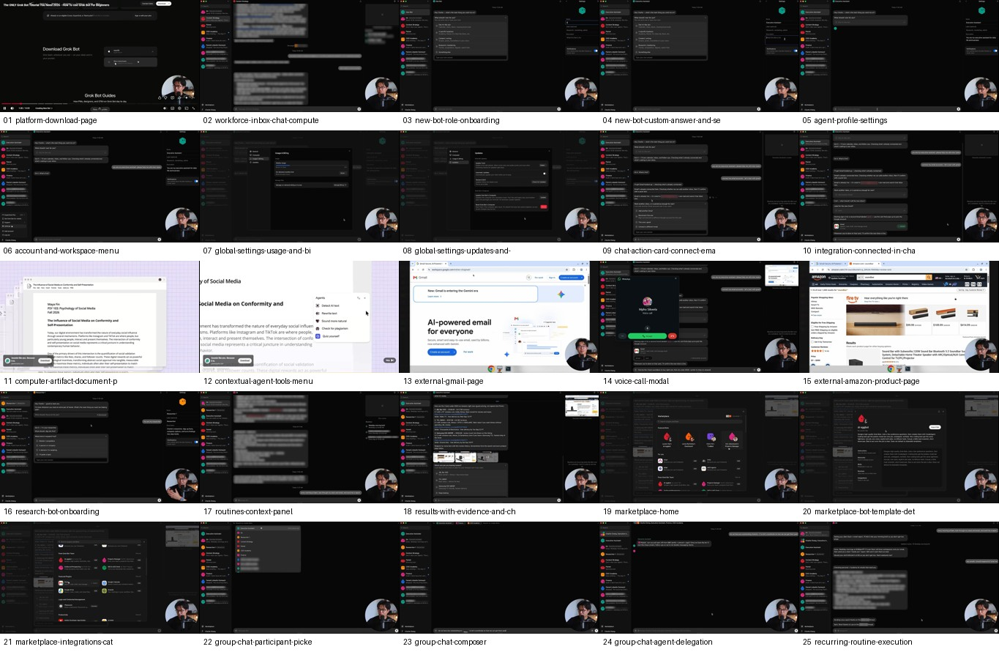

# BUILD BOT video-reference screenshot index

Source: `Screen Recording 2026-10-11 181512.mp4` (12:58, 1364×766).

These screenshots are evidence from the user-supplied walkthrough. They are not application assets and must not ship in BUILD BOT. The recording contains third-party branding, example data, blurred/private content, a presenter overlay, and external websites. Reproduce the observed interaction patterns with BUILD BOT branding and original implementation; do not copy names, logos, proprietary text, or source code.

| # | Time | Screenshot | Observed state |
|---:|---:|---|---|
| 1 | 00:00 | [Platform download page](screenshots/01-platform-download-page.jpg) | Public/download page and desktop-client entry point. |
| 2 | 00:15 | [Workforce inbox, chat, computer pane](screenshots/02-workforce-inbox-chat-computer-pane.jpg) | Core three-panel workspace: roster, conversation, live computer/context. |
| 3 | 00:30 | [New-bot role onboarding](screenshots/03-new-bot-role-onboarding.jpg) | Conversational bot creation with quick answers and settings visible. |
| 4 | 00:35 | [New-bot custom answer and settings](screenshots/04-new-bot-custom-answer-and-settings.jpg) | Custom onboarding answer plus editable identity fields. |
| 5 | 00:55 | [Agent profile settings](screenshots/05-agent-profile-settings.jpg) | Name, label, instructions/description, and notification preference. |
| 6 | 01:20 | [Account and workspace menu](screenshots/06-account-and-workspace-menu.jpg) | Subscription, help, settings, account switching, and sign-out entry points. |
| 7 | 01:25 | [Usage and billing settings](screenshots/07-global-settings-usage-and-billing.jpg) | Weekly usage, remaining allowance, limits, and billing management. |
| 8 | 01:35 | [Updates and computer settings](screenshots/08-global-settings-updates-and-computer.jpg) | Update track, automatic updates, computer update, and reset/recovery. |
| 9 | 02:00 | [Chat action card for email connection](screenshots/09-chat-action-card-connect-email.jpg) | Agent discovers missing capability and presents a bounded next-action choice. |
| 10 | 02:10 | [Connected integration in chat](screenshots/10-integration-connected-in-chat.jpg) | Connection success is reflected in the conversation before execution resumes. |
| 11 | 02:30 | [Computer artifact/document preview](screenshots/11-computer-artifact-document-preview.jpg) | Generated result opens in a computer surface with download control. |
| 12 | 02:35 | [Contextual agent tools menu](screenshots/12-contextual-agent-tools-menu.jpg) | Agent-assisted operations embedded in the external work surface. |
| 13 | 04:00 | [External Gmail page](screenshots/13-external-gmail-page.jpg) | External service opened by the agent; reference for computer execution only. |
| 14 | 04:30 | [Voice-call modal](screenshots/14-voice-call-modal.jpg) | Inbound/outbound call state with accept/end and channel identity. |
| 15 | 04:50 | [External Amazon product page](screenshots/15-external-amazon-product-page.jpg) | Browser research/shopping execution; do not clone the external site. |
| 16 | 05:55 | [Research-bot onboarding](screenshots/16-research-bot-onboarding.jpg) | A second role-specific creation flow demonstrates reusable onboarding logic. |
| 17 | 06:40 | [Routines context panel](screenshots/17-routines-context-panel.jpg) | Agent screen plus recurring routines, schedule, and next-run context. |
| 18 | 08:05 | [Results, evidence, and choice card](screenshots/18-results-with-evidence-and-choice-card.jpg) | Ranked answer, links, screenshots, follow-up options, and conversational closure. |
| 19 | 08:40 | [Marketplace home](screenshots/19-marketplace-home.jpg) | Search, installed count, featured bots, recommendations, and add actions. |
| 20 | 08:45 | [Bot-template detail](screenshots/20-marketplace-bot-template-detail.jpg) | Author, import, overview, instructions, memories, skills, routines, integrations. |
| 21 | 09:15 | [Integrations catalog](screenshots/21-marketplace-integrations-catalog.jpg) | Plugins organized by category with Add/Connect/Added states. |
| 22 | 09:55 | [Group-chat participant picker](screenshots/22-group-chat-participant-picker.jpg) | Search or select bots and add them to a new group. |
| 23 | 10:00 | [Group-chat composer](screenshots/23-group-chat-composer.jpg) | Selected-agent chips and a shared composer before first send. |
| 24 | 10:20 | [Group-chat agent delegation](screenshots/24-group-chat-agent-delegation.jpg) | One agent assigns scoped work to another inside the shared thread. |
| 25 | 11:20 | [Recurring-routine execution](screenshots/25-recurring-routine-execution.jpg) | Scheduled routine confirmation, live progress, and external communication result. |

The implementation prompt that translates these observations into BUILD BOT behavior is [`planning/12_VIDEO_DERIVED_MASTER_PLATFORM_PROMPT.md`](../../planning/12_VIDEO_DERIVED_MASTER_PLATFORM_PROMPT.md).
